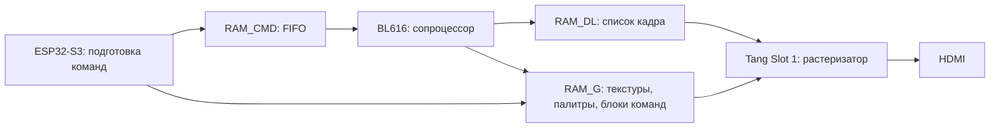

# API аппаратных команд FT812 в VDAC4

Справочник 2D-команд, используемых портом HMM2 для **ZX Evolution с VDAC4**:
спрайты, прокрутка, отсечение, палитры, прозрачность окон, тени и операции с памятью.
Версия документа: 8 ноября 2026 года.

Форматы сверены с опубликованной реализацией VDAC4
[`80c4872`](https://github.com/andrewinsidelazarev/VDAC4/tree/80c4872cc90cb22bdae3472c0265978b33b397fc).
Поддержка расширений определяется установленными версиями ядра Tang и прошивки BL616.
Здесь описан используемый 2D-интерфейс; это не обещание поддержки всех команд
из заголовочных файлов любых поколений EVE.

## Содержание

- [Устройство интерфейса](#устройство-интерфейса)
- [Память и регистры](#память-и-регистры)
- [Координаты и числовые форматы](#координаты-и-числовые-форматы)
- [Команды дисплей-листа](#команды-дисплей-листа)
- [Настройка и вывод спрайтов](#настройка-и-вывод-спрайтов)
- [Отсечение и прокрутка](#отсечение-и-прокрутка)
- [Прозрачность, окна и тени](#прозрачность-окна-и-тени)
- [Команды сопроцессора](#команды-сопроцессора)
- [FIFO и публикация кадра](#fifo-и-публикация-кадра)
- [Ошибки и ограничения](#ошибки-и-ограничения)
- [Где это используется в HMM2](#где-это-используется-в-hmm2)
- [Первичные источники](#первичные-источники)

## Устройство интерфейса

В VDAC4 роль FT812 разделена между Tang и BL616:



Есть два разных вида команд:

| Вид | Представление | Исполнитель | Пример |
| --- | --- | --- | --- |
| Команда дисплей-листа, DL | Одно 32-битное слово | Растеризатор Tang | `COLOR_A`, `SCISSOR_XY`, `VERTEX2F` |
| Команда сопроцессора | Код `0xFFFFFFxx`, параметры и иногда поток байтов | BL616 | `CMD_MEMCPY`, `CMD_APPEND`, `CMD_INFLATE` |

Обычные DL-слова можно передавать через `RAM_CMD`: сопроцессор добавит их в
строящийся `RAM_DL`. Коды `CMD_*` нельзя класть в готовый DL как команды рисования.

Позиция спрайта задаётся вершиной и переносом координат. Текстура остаётся в
`RAM_G`: перемещение объекта не требует копировать его пиксели в фон. Результат
смешивания и отсечения получает растеризатор при исполнении списка.

## Память и регистры

Адреса ниже — адреса в пространстве FT812, а не указатели в адресном пространстве ESP.

| Область / регистр | Адрес | Размер / смысл |
| --- | --- | --- |
| `RAM_G` | `0x000000` | В используемой HMM2 конфигурации Slot 1 — **3 МиБ**, до `0x2FFFFF` включительно |
| `RAM_DL` | `0x300000` | **8192 байта = 2048 32-битных слов**, включая завершающий `DISPLAY` |
| `RAM_CMD` | `0x308000` | Кольцевой FIFO на 4096 байт; смещения `0…4095` |
| `REG_CPURESET` | `0x302020` | Бит 0 удерживает сопроцессор в сбросе |
| `REG_DLSWAP` | `0x302054` | `2` — запрос смены списка на кадре; `0` — запрос выполнен |
| `REG_ROTATE` | `0x302058` | Регистр поворота дисплея, используемый `CMD_SETROTATE` |
| `REG_CMD_READ` | `0x3020F8` | Смещение чтения FIFO; **`0xFFF` означает CMD fault** |
| `REG_CMD_WRITE` | `0x3020FC` | Опубликованное хостом смещение записи FIFO |
| `REG_CMD_DL` | `0x302100` | Байтовое смещение следующего слова строящегося DL |
| `REG_MEDIAFIFO_READ` | `0x309014` | Смещение чтения медиа-FIFO в `RAM_G` |
| `REG_MEDIAFIFO_WRITE` | `0x309018` | Смещение записи медиа-FIFO |

У физического FT812 объём `RAM_G` другой; **3 МиБ — свойство данной конфигурации
эмулятора VDAC4**. Увеличение `RAM_G` не увеличивает размер `RAM_DL`.
8192 команды заняли бы 32 КиБ и в этот DL не помещаются.

При размещении своих данных учитывайте области, занятые прошивкой, шрифтами
и другими клиентами. В частности, `ft_copro.h` определяет `FTC_ROM_FONTROOT =
0x2FFFFC` для таблицы ПЗУ-шрифтов. Кэш HMM2 распределяет память через `hft_cache`;
его адреса нельзя считать свободными для независимого загрузчика ресурсов.

Все слова и поля параметров передаются в порядке **little-endian**.
Вызов `hmm_core->ft_write(address, words, count)` принимает `count` в
**32-битных словах**, тогда как длина `CMD_APPEND` и `CMD_MEMCPY` задаётся в байтах.

## Координаты и числовые форматы

| Параметр | Формат |
| --- | --- |
| `VERTEX2F(x,y)` | Два знаковых 15-битных значения; дробность задаёт `VERTEX_FORMAT` |
| `VERTEX_FORMAT(frac)` | Обычно `0…4`; при `4` координата вершины задаётся в 1/16 пикселя |
| `VERTEX2II(x,y,handle,cell)` | `x,y`: беззнаковые 9-битные целые пиксели `0…511` |
| `VERTEX_TRANSLATE_X/Y` | Знаковое 17-битное значение, всегда в **1/16 пикселя** |
| `SCISSOR_XY` | Беззнаковые целые пиксели, по 11 бит на координату |
| `SCISSOR_SIZE` | Беззнаковые целые пиксели, по 12 бит на размер |
| `POINT_SIZE` | 13 бит, радиус в 1/16 пикселя |
| `LINE_WIDTH` | 12 бит, полуширина линии / радиус скругления в 1/16 пикселя |
| `BITMAP_TRANSFORM_A/B/D/E` | Знаковые 17 бит, 8 дробных бит; единица — `256` |
| `BITMAP_TRANSFORM_C/F` | Знаковые 24 бита, 8 дробных бит |
| `CMD_TRANSLATE`, `CMD_SCALE` | Знаковый формат **16.16** |
| `CMD_ROTATE` | `65536` единиц на полный оборот |

Пример: при `VERTEX_FORMAT(4)` точка `(100,50)` кодируется как `(1600,800)`.
Перенос камеры на минус 32 пикселя по X — `VERTEX_TRANSLATE_X(-512)`.
Для пиксельной графики HMM2 применяет `NEAREST` и контролирует целую фазу вывода.

## Команды дисплей-листа

В таблицах `op` означает старший байт слова. Выражение в столбце «поле»
добавляется к `op << 24`. Входные значения должны помещаться в указанные поля.

### Цвет, очистка, смешивание

| Команда | `op` | Поле | Действие |
| --- | --- | --- | --- |
| `DISPLAY()` | `0x00` | `0` | Завершить DL; итоговое слово равно нулю |
| `CLEAR_COLOR_RGB(r,g,b)` | `0x02` | `(r<<16) \| (g<<8) \| b` | Цвет последующего `CLEAR` |
| `COLOR_RGB(r,g,b)` | `0x04` | `(r<<16) \| (g<<8) \| b` | Множитель RGB для следующих примитивов |
| `BLEND_FUNC(src,dst)` | `0x0B` | `(src<<3) \| dst` | Множители смешивания, по 3 бита |
| `CLEAR_COLOR_A(a)` | `0x0F` | `a`, 8 бит | Альфа очистки |
| `COLOR_A(a)` | `0x10` | `a`, 8 бит | Общий множитель исходной альфы следующих примитивов |
| `COLOR_MASK(r,g,b,a)` | `0x20` | `(r<<3) \| (g<<2) \| (b<<1) \| a` | Разрешение записи каналов, по одному биту |
| `CLEAR(c,s,t)` | `0x26` | `(c<<2) \| (s<<1) \| t` | Очистить цвет / stencil / стандартное поле tag |

`CLEAR_COLOR_*` только задают состояние: очистка выполняется командой `CLEAR`.
Для полного кадра предварительно установите полный scissor и нужную маску каналов.
Tag не является API мыши HMM2: ввод игры приходит через Z80/ESP.

Коды множителей `BLEND_FUNC`:

| Код | Имя | Значение |
| --- | --- | --- |
| `0` | `ZERO` | `0` |
| `1` | `ONE` | `1` |
| `2` | `SRC_ALPHA` | Альфа исходного фрагмента |
| `3` | `DST_ALPHA` | Альфа уже нарисованного фрагмента |
| `4` | `ONE_MINUS_SRC_ALPHA` | `1 − SRC_ALPHA` |
| `5` | `ONE_MINUS_DST_ALPHA` | `1 − DST_ALPHA` |

Обычная прозрачность — `BLEND_FUNC(2,4)`, слово `0x0B000014`.
Смешивание идёт в порядке примитивов DL; смена порядка полупрозрачных объектов
может изменить результат. Побитовое округление цветов следует реализации
растеризатора, а не произвольной формуле с плавающей точкой.

### Битмапы и палитры

| Команда | `op` | Поле |
| --- | --- | --- |
| `BITMAP_SOURCE(addr)` | `0x01` | Адрес, младшие 22 бита |
| `BITMAP_HANDLE(h)` | `0x05` | Номер дескриптора `0…31` |
| `CELL(c)` | `0x06` | Номер ячейки `0…127` |
| `BITMAP_LAYOUT(format,stride,height)` | `0x07` | `(format<<19) \| ((stride&1023)<<9) \| (height&511)` |
| `BITMAP_SIZE(filter,wrapX,wrapY,w,h)` | `0x08` | `(filter<<20) \| (wrapX<<19) \| (wrapY<<18) \| ((w&511)<<9) \| (h&511)` |
| `BITMAP_LAYOUT_H(strideHi,heightHi)` | `0x28` | `(strideHi<<2) \| heightHi`, по 2 бита |
| `BITMAP_SIZE_H(widthHi,heightHi)` | `0x29` | `(widthHi<<2) \| heightHi`, по 2 бита |
| `PALETTE_SOURCE(addr)` | `0x2A` | Адрес палитры, младшие 22 бита |

`BITMAP_SOURCE`, `LAYOUT`, `LAYOUT_H`, `SIZE` и `SIZE_H` относятся к выбранному
`BITMAP_HANDLE`. Эти поля образуют таблицу из 32 дескрипторов.
`VERTEX2II` выбирает handle и cell непосредственно в слове вершины;
`VERTEX2F` использует текущие `BITMAP_HANDLE` и `CELL`.

Разрядность полного шага строки — 12 бит, высоты раскладки — 11 бит.
`LAYOUT_H` получает `stride >> 10` и `height >> 9`.
`SIZE_H` получает `width >> 9` и `height >> 9`.
У полей размера вывода нулевое 11-битное представление означает 2048,
поэтому `BITMAP_SIZE(...,0,0)` не следует использовать как способ скрыть объект.

`stride` — **байты на строку источника**, `LAYOUT.height` — высота одной ячейки.
Начало ячейки: `source + cell * stride * layout_height`.
`BITMAP_SIZE` задаёт размер прямоугольника вывода, а не выполняет масштабирование
текстуры: для масштаба нужна матрица преобразования.

Фильтрация: `NEAREST=0`, `BILINEAR=1`. Обёртка: `BORDER=0`, `REPEAT=1`.
При BORDER выборка за границей источника прозрачная; при REPEAT координаты повторяются.

Основные форматы HMM2:

| Код | Формат | Память / применение |
| --- | --- | --- |
| `1` | `L1` | 8 точек в байте, старший бит первым; маски теней. В данном растеризаторе белая маска с альфой 0/255 модулируется `COLOR_RGB/A` |
| `7` | `RGB565` | 2 байта на точку, little-endian; кадры роликов |
| `16` | `PALETTED8` | Байт индекса + палитра из 256 32-битных цветов; спрайты и фон |

Для `PALETTED8` HMM2 использует слова палитры `0xAARRGGBB`:
в памяти байты располагаются как `B,G,R,A`. Непрозрачный цвет имеет `A=255`.
Одна палитра занимает 1024 байта. Общая палитра относится к состоянию рисования;
она не является отдельным полем каждого bitmap handle.

### Геометрия, отсечение и перенос

| Команда | `op` / старшие биты | Поле |
| --- | --- | --- |
| `BEGIN(primitive)` | `0x1F` | Номер примитива, младшие 4 бита |
| `END()` | `0x21` | `0` |
| `VERTEX_FORMAT(frac)` | `0x27` | Дробность координат, младшие 3 бита; рабочий диапазон `0…4` |
| `VERTEX2F(x,y)` | `01` в битах `31:30` | `0x40000000 \| ((x&32767)<<15) \| (y&32767)` |
| `VERTEX2II(x,y,h,c)` | `10` в битах `31:30` | `0x80000000 \| (x<<21) \| (y<<12) \| (h<<7) \| c` |
| `VERTEX_TRANSLATE_X(x16)` | `0x2B` | Знаковое поле из 17 бит |
| `VERTEX_TRANSLATE_Y(y16)` | `0x2C` | Знаковое поле из 17 бит |
| `SCISSOR_XY(x,y)` | `0x1B` | `(x<<11) \| y`, по 11 бит |
| `SCISSOR_SIZE(w,h)` | `0x1C` | `(w<<12) \| h`, по 12 бит |
| `POINT_SIZE(radius16)` | `0x0D` | 13 бит |
| `LINE_WIDTH(radius16)` | `0x0E` | 12 бит |

Используемые здесь примитивы: `BITMAPS=1`, `POINTS=2`, `LINES=3`, `RECTS=9`.
BITMAPS рисует битмап по одной вершине; RECTS использует пары вершин.
`LINE_WIDTH` влияет на скругление RECTS: это не только атрибут линий.
Совместимость остальных разновидностей линий/полос нужно проверять по версии ядра;
этот справочник не объявляет их необходимой частью API HMM2.

### Матрица битмапа

| Команда | `op` | Поле |
| --- | --- | --- |
| `BITMAP_TRANSFORM_A(a)` | `0x15` | Знаковые 17 бит, 8 дробных |
| `BITMAP_TRANSFORM_B(b)` | `0x16` | Знаковые 17 бит, 8 дробных |
| `BITMAP_TRANSFORM_C(c)` | `0x17` | Знаковые 24 бита, 8 дробных |
| `BITMAP_TRANSFORM_D(d)` | `0x18` | Знаковые 17 бит, 8 дробных |
| `BITMAP_TRANSFORM_E(e)` | `0x19` | Знаковые 17 бит, 8 дробных |
| `BITMAP_TRANSFORM_F(f)` | `0x1A` | Знаковые 24 бита, 8 дробных |

Это преобразование из координат области вывода в координаты выборки текстуры.
Единичная матрица: `A=E=256`, `B=C=D=F=0`. Для визуального увеличения текстуры
вдвое коэффициенты выборки `A,E` уменьшаются вдвое. Команды сопроцессора
`CMD_SCALE` и `CMD_SETMATRIX` выполняют соответствующий перевод автоматически.
Матричный сдвиг выборки `C/F` и перенос геометрии `VERTEX_TRANSLATE_X/Y` решают разные задачи.

### Контекст, переходы, stencil

| Команда | `op` | Параметры / смысл |
| --- | --- | --- |
| `SAVE_CONTEXT()` | `0x22` | Сохранить графический контекст |
| `RESTORE_CONTEXT()` | `0x23` | Восстановить графический контекст |
| `CALL(dest)` | `0x1D` | Вызов по **номеру слова** `RAM_DL`, `0…2047` |
| `JUMP(dest)` | `0x1E` | Переход по **номеру слова** `RAM_DL` |
| `RETURN()` | `0x24` | Возврат из `CALL` |
| `ALPHA_FUNC(func,ref)` | `0x09` | `(func<<8) \| ref`: сравнение альфы с 8-битным ref |
| `STENCIL_FUNC(func,ref,mask)` | `0x0A` | `(func<<16) \| (ref<<8) \| mask` |
| `STENCIL_OP(fail,pass)` | `0x0C` | `(fail<<3) \| pass` |
| `CLEAR_STENCIL(s)` | `0x11` | 8-битное значение очистки stencil |
| `STENCIL_MASK(mask)` | `0x13` | 8-битная маска записи stencil |

Функции сравнения: `NEVER=0`, `LESS=1`, `LEQUAL=2`, `GREATER=3`, `GEQUAL=4`,
`EQUAL=5`, `NOTEQUAL=6`, `ALWAYS=7`.
Операции stencil: `ZERO=0`, `KEEP=1`, `REPLACE=2`, `INCR=3`, `DECR=4`, `INVERT=5`.

Контекст и стек возвратов — разные механизмы; глубина каждого в данной
реализации — **4**. CALL не сохраняет графическое состояние автоматически.
SAVE/RESTORE не копирует `RAM_G` и не сохраняет содержимое таблицы bitmap-дескрипторов.
При изменении дескриптора снова задавайте нужные SOURCE/LAYOUT/SIZE.

При вставке блока через `CMD_APPEND` адреса CALL/JUMP **не перебазируются**.
Если блок оказался со слова `base`, его внутренние адреса необходимо заранее
перевести в номера слов итогового DL. Адрес в байтах и адрес `RAM_G` здесь неверны.
Циклические переходы недопустимы: наличие ограничителей обходчика не делает их API анимации.

## Настройка и вывод спрайтов

### Небольшие функции кодирования

Это самостоятельные вспомогательные функции для примеров, не новые команды VDAC4
и не готовый транспорт SPI/LINK. Они возвращают одно DL-слово.

```cpp
#include <stdint.h>

static constexpr uint32_t ft_rgb(uint32_t r, uint32_t g, uint32_t b) {
    return 0x04000000u | ((r & 255u) << 16) | ((g & 255u) << 8) | (b & 255u);
}
static constexpr uint32_t ft_alpha(uint32_t a) {
    return 0x10000000u | (a & 255u);
}
static constexpr uint32_t ft_scissor_xy(uint32_t x, uint32_t y) {
    return 0x1b000000u | ((x & 2047u) << 11) | (y & 2047u);
}
static constexpr uint32_t ft_scissor_size(uint32_t w, uint32_t h) {
    return 0x1c000000u | ((w & 4095u) << 12) | (h & 4095u);
}
static constexpr uint32_t ft_translate_x(int32_t x16) {
    return 0x2b000000u | ((uint32_t)x16 & 0x1ffffu);
}
static constexpr uint32_t ft_translate_y(int32_t y16) {
    return 0x2c000000u | ((uint32_t)y16 & 0x1ffffu);
}
static constexpr uint32_t ft_vertex2f(int32_t x16, int32_t y16) {
    return 0x40000000u | (((uint32_t)x16 & 32767u) << 15)
                       | ((uint32_t)y16 & 32767u);
}
static constexpr uint32_t ft_vertex2ii(uint32_t x, uint32_t y,
                                     uint32_t handle, uint32_t cell) {
    return 0x80000000u | ((x & 511u) << 21) | ((y & 511u) << 12)
                       | ((handle & 31u) << 7) | (cell & 127u);
}
```

Функции маскируют поля, но не проверяют диапазоны. Переполненную координату
нужно отсеять или преобразовать до упаковки, иначе она завернётся.

### Спрайт PALETTED8 32×32

Пусть `RAM_G[0x10000…]` содержит ячейки по 1024 байта, а по `0x08000`
загружена палитра из 256 цветов. Это условные адреса примера: их должен выделить
ваш менеджер памяти, они не являются зарезервированными адресами игры.

```cpp
const uint32_t sprite_dl[] = {
    0x05000000u,                      // BITMAP_HANDLE(0)
    0x01010000u,                      // BITMAP_SOURCE(0x10000)
    0x07000000u | (16u << 19) | (32u << 9) | 32u,
    0x28000000u,                      // LAYOUT_H: старшие биты = 0
    0x08000000u | (32u << 9) | 32u,    // SIZE: NEAREST, BORDER, 32x32
    0x29000000u,                      // SIZE_H: старшие биты = 0
    0x2a008000u,                      // PALETTE_SOURCE(0x08000)
    ft_rgb(255,255,255), ft_alpha(255),
    0x0b000014u,                      // BLEND_FUNC(SRC_ALPHA, ONE_MINUS_SRC_ALPHA)
    0x1f000001u,                      // BEGIN(BITMAPS)
    ft_vertex2ii(100,80,0,0),          // первый экземпляр, ячейка 0
    ft_vertex2ii(150,80,0,0),          // та же текстура, другая позиция
    ft_vertex2ii(200,80,0,1),          // ячейка 1, если она загружена
    0x21000000u                       // END
};
```

Это фрагмент DL: полный кадр должен задать исходный контекст, матрицу,
scissor, `VERTEX_FORMAT`, перенос и закончиться `DISPLAY()`.
Одинаковые монстры используют общую текстуру и разные вершины.
Не требуется отдельная картинка «фон с уже наложенным монстром» для каждой позиции.

## Отсечение и прокрутка

`SCISSOR_XY(x,y)` и `SCISSOR_SIZE(w,h)` задают прямоугольник
`[x,x+w) × [y,y+h)` в координатах экрана. Отсечение выполняется при рисовании:
текстура и координаты источника не переписываются.

```cpp
// Фрагмент для прямоугольника карты. camera_* — положение камеры в пикселях.
const uint32_t map_begin[] = {
    0x22000000u,                     // SAVE_CONTEXT
    ft_scissor_xy(16,16),
    ft_scissor_size(448,448),
    0x27000004u,                     // VERTEX_FORMAT(4)
    ft_translate_x(-camera_x * 16),
    ft_translate_y(-camera_y * 16),
    0x1f000001u                      // BEGIN(BITMAPS)
};
// Затем — вершины в координатах мира; можно использовать VERTEX2F.
// После карты: END, RESTORE_CONTEXT, далее интерфейс экрана.
```

При неизменной видимой геометрии скролл меняет команды переноса.
Новые полосы фона и новые ресурсы загружаются при необходимости; уже загруженные
спрайты для каждого пиксельного сдвига повторно копировать не нужно.

Scissor не вырезает сами команды из DL и не уменьшает его размер.
Для сокращения работы ESP и числа команд полностью невидимые объекты нужно
не включать в список. Туман войны имеет произвольную форму, поэтому одного
прямоугольного scissor для него недостаточно: HMM2 дополнительно проверяет
видимость объектов и выводит геометрию тумана нужным слоем.

## Прозрачность, окна и тени

### Альфа отдельного объекта

При стандартном смешивании `COLOR_A(128)` делает непрозрачную текстуру примерно
наполовину прозрачной. Собственная альфа текселя и `COLOR_A` перемножаются.
`COLOR_RGB(255,255,255)` сохраняет исходные цвета; другой цвет модулирует RGB.

`COLOR_A` — состояние последующих примитивов. Следующая команда `COLOR_A`
заменяет предыдущую: это не автоматически вложенный слой прозрачности.

### Тень маской

1. Загрузить маску L1 в `RAM_G` и настроить её handle/размер.
2. Установить `COLOR_RGB(0,0,0)` и, например, `COLOR_A(96)`.
3. Нарисовать маску со смещением относительно окна.
4. Восстановить белый RGB и требуемую альфу для рамки и содержимого.

Тень смешивается с уже нарисованным фоном самим растеризатором.
Сохранять пиксели фона под ней не нужно: при следующем кадре сцена снова
формируется из фонового списка и команд окна. Геометрия тени может быть
набором масок/примитивов, а не одним прямоугольником.

### Общий fade окна вместе с содержимым и тенью

Если у элемента исходная альфа `local_alpha`, а у окна — `window_alpha`,
в его `COLOR_A` передаётся:

```cpp
uint32_t effective_alpha = (local_alpha * window_alpha + 127u) / 255u;
```

Поэтому рамка, текст и тень получают общий fade, сохраняя относительную
прозрачность. Фон и курсор должны использовать свою исходную альфу.

В HMM2 для окон с тенью используются три опубликованных состояния открытия
`85 → 170 → 255` и закрытия `170 → 85 → 0`. Это три кадра, а не три обязательные
паузы по миллисекундам. Для обычных экранов игры этот механизм не вводит новый fade.
Реализация сохраняет команды фоновой сцены и ссылки на текстуры, а не снимок
пикселей экрана. При нулевой альфе окно можно не рисовать, но фон кадра остаётся.

### Анимация воды палитрой

В PALETTED8 можно оставить индексы точек в `RAM_G` и менять нужные записи
палитры. `PALETTE_SOURCE` выбирает палитру текущего прохода. Это не требует
создавать новую текстуру каждого водного тайла для каждой фазы.
Изменение общей палитры затронет все примитивы, которые на неё ссылаются;
порядок публикации палитры и использующего её кадра должен быть согласован.

## Команды сопроцессора

Команда начинается с 32-битного кода `0xFFFFFFxx`.
Число в столбце «слова» — количество **параметров после кода**, без самого кода.
Потоки байтов и строки описаны отдельно. Все 16-битные поля упаковываются
попарно в little-endian слово; знаковые координаты перед упаковкой приводятся к `uint16_t`.

### Список кадра и память

| Команда | Код | Слова | Параметры / результат |
| --- | --- | --- | --- |
| `CMD_DLSTART()` | `0xFFFFFF00` | 0 | Начать новый DL; ждёт завершения предыдущего DLSWAP |
| `CMD_SWAP()` | `0xFFFFFF01` | 0 | Запросить смену DL через `REG_DLSWAP=2` |
| `CMD_INTERRUPT(ms)` | `0xFFFFFF02` | 1 | Задержанная сигнализация прерывания сопроцессора |
| `CMD_MEMCRC(ptr,num,result)` | `0xFFFFFF18` | 3 | CRC32 диапазона; `result` — перезаписываемое слово параметра |
| `CMD_REGREAD(ptr,result)` | `0xFFFFFF19` | 2 | Прочитать регистр; результат возвращается в слово параметра |
| `CMD_MEMWRITE(ptr,num)` | `0xFFFFFF1A` | 2 + данные | Записать следующие `num` байтов по адресу `ptr` |
| `CMD_MEMSET(ptr,value,num)` | `0xFFFFFF1B` | 3 | Заполнить `num` байтов младшим байтом `value` |
| `CMD_MEMZERO(ptr,num)` | `0xFFFFFF1C` | 2 | Заполнить `num` байтов нулями |
| `CMD_MEMCPY(dst,src,num)` | `0xFFFFFF1D` | 3 | Скопировать `num` байтов между областями памяти |
| `CMD_APPEND(ptr,num)` | `0xFFFFFF1E` | 2 | Добавить `num` байтов DL из `RAM_G` в текущий `RAM_DL` |
| `CMD_INFLATE(ptr)` | `0xFFFFFF22` | 1 + поток | Распаковать поток zlib из FIFO в память с `ptr` |
| `CMD_GETPTR(result)` | `0xFFFFFF23` | 1 | Получить сохранённый указатель конца распакованных данных |
| `CMD_COLDSTART()` | `0xFFFFFF32` | 0 | Вернуть состояние сопроцессора к исходному |

Для MEMWRITE после полезных байтов идут байты дополнения до границы 4;
они не входят в `num`. INFLATE получает поток **zlib с заголовком**, а не произвольный
raw DEFLATE; после конца потока также соблюдается 4-байтовое выравнивание FIFO.

MEMCPY в этой реализации выполняется **вперёд**. Если `dst > src` и области
перекрываются, следующие чтения могут увидеть уже записанные байты. Это не
контракт `memmove`: для обычного переноса ресурсов используйте непересекающиеся области.

APPEND копирует слова команд, а не рисует картинку. `ptr` и `num` должны быть
кратны 4; итоговый DL всё равно обязан уложиться в 2048 слов. Ни INFLATE,
ни APPEND не расширяет аппаратную ёмкость RAM_DL.

Параметры с именем `result` — **не адрес назначения в RAM_G**. Сопроцессор
записывает результат обратно в соответствующий параметр в `RAM_CMD`.
Хост сохраняет смещение этого слова, ждёт окончания команды, читает его и
только затем позволяет кольцу перезаписать этот участок.

### Матрица и дескрипторы

| Команда | Код | Слова | Параметры / действие |
| --- | --- | --- | --- |
| `CMD_LOADIDENTITY()` | `0xFFFFFF26` | 0 | Единичная внутренняя матрица сопроцессора |
| `CMD_TRANSLATE(tx,ty)` | `0xFFFFFF27` | 2 | Сдвиг в 16.16 |
| `CMD_SCALE(sx,sy)` | `0xFFFFFF28` | 2 | Масштаб в 16.16; для ×2 передать `131072` |
| `CMD_ROTATE(angle)` | `0xFFFFFF29` | 1 | Поворот; четверть оборота — `16384` |
| `CMD_SETMATRIX()` | `0xFFFFFF2A` | 0 | Записать шесть команд `BITMAP_TRANSFORM_*` в DL |
| `CMD_GETMATRIX(a,b,c,d,e,f)` | `0xFFFFFF33` | 6 | Шесть возвращаемых слов внутренней матрицы 16.16 |
| `CMD_SETROTATE(r)` | `0xFFFFFF36` | 1 | Установить поворот дисплея; не заменяет перенос отдельного спрайта |
| `CMD_SETBITMAP(ptr,format,w,h)` | `0xFFFFFF43` | 3 | Сформировать SOURCE/SIZE/LAYOUT для текущего handle |

Параметры SETBITMAP упакованы так:

```cpp
uint32_t set_bitmap[] = {
    0xffffff43u,
    address,
    (width << 16) | format,
    height
};
```

Структура вызова не равна четырём отдельным 32-битным параметрам после кода.
Матрицу сопроцессора нужно завершить SETMATRIX, чтобы она попала в DL.
Для обычного скролла выгоднее VERTEX_TRANSLATE; менять матрицу каждой текстуры не требуется.

### Текст и простые элементы интерфейса

| Команда | Код | Слова | Упаковка параметров |
| --- | --- | --- | --- |
| `CMD_BGCOLOR(rgb)` | `0xFFFFFF09` | 1 | Цвет фона элемента, 24 бита |
| `CMD_FGCOLOR(rgb)` | `0xFFFFFF0A` | 1 | Цвет переднего плана элемента |
| `CMD_GRADIENT(x0,y0,rgb0,x1,y1,rgb1)` | `0xFFFFFF0B` | 4 | `xy0`, `rgb0`, `xy1`, `rgb1` |
| `CMD_TEXT(x,y,font,options,text)` | `0xFFFFFF0C` | 2 + строка | `x \| y<<16`, `font \| options<<16`, строка с NUL |
| `CMD_PROGRESS(x,y,w,h,options,val,range)` | `0xFFFFFF0F` | 4 | `xy`, `wh`, `options \| val<<16`, `range` |
| `CMD_SETFONT(font,ptr)` | `0xFFFFFF2B` | 2 | Номер пользовательского шрифта и адрес его метрик |
| `CMD_NUMBER(x,y,font,options,n)` | `0xFFFFFF2E` | 3 | `xy`, `font \| options<<16`, число |
| `CMD_GRADCOLOR(rgb)` | `0xFFFFFF34` | 1 | Дополнительный цвет градиентных элементов |
| `CMD_SETBASE(base)` | `0xFFFFFF38` | 1 | Система счисления для NUMBER |
| `CMD_SETSCRATCH(handle)` | `0xFFFFFF3C` | 1 | Служебный bitmap handle сопроцессора |

В CMD_TEXT строка обязательно завершается NUL и дополняется до границы 4 байт.
`FTC_TEXT_MAX` в проверенном снимке равен 256; это не интерфейс произвольной
длины Unicode-текста. Наличие имён CMD_BUTTON/CMD_KEYS и других виджетов
в чужом SDK не означает их поддержку данным сопроцессором.

Поддерживаемые варианты позиционирования текста: `OPT_CENTERX=512`,
`OPT_CENTERY=1024`, `OPT_CENTER=1536`, `OPT_RIGHTX=2048`.
Для NUMBER `OPT_SIGNED=256` включает знаковую трактовку числа;
младшие биты options также используются кодом NUMBER для ширины записи.

SETFONT устанавливает пользовательские шрифты `0…15`; ROM-шрифты — `16…31`.
Метрики стандартного пользовательского шрифта занимают 148 байт:
128 байтов ширины символов и пять 32-битных полей `format,stride,width,height,ptr`.
Шрифты самой HMM2 обычно выводятся как её исходные bitmap-глифы, поэтому
CMD_TEXT не является обязательным путём отрисовки текста игры.

### Изображения и видео

| Команда | Код | Слова | Параметры / действие |
| --- | --- | --- | --- |
| `CMD_LOADIMAGE(ptr,options)` | `0xFFFFFF24` | 2 + поток | Декодировать изображение из RAM_CMD через `ft_image.c` |
| `CMD_GETPROPS(ptr,w,h)` | `0xFFFFFF25` | 3 | Возвращаемые слова свойств последней картинки |
| `CMD_MEDIAFIFO(ptr,size)` | `0xFFFFFF39` | 2 | Создать кольцо байтов в RAM_G |
| `CMD_VIDEOSTART()` | `0xFFFFFF40` | 0 | Начать разбор MJPEG AVI из медиа-FIFO |
| `CMD_VIDEOFRAME(dst,remaining)` | `0xFFFFFF41` | 2 | Декодировать очередной кадр в RGB565; второй аргумент — адрес слова результата в RAM_G |

Для LOADIMAGE базовые опции — `OPT_MONO=1`, `OPT_NODL=2`.
Возвращаемый `GETPROPS.ptr` не всегда равен началу картинки: для обычного
JPEG реализация возвращает начало, для PNG — конец выходных данных.
Форматы и ограничения декодера зависят от его версии; HMM2 использует JPEG/PNG
в соответствующих путях подготовки/вывода. Список поддерживаемых разновидностей
изображений проверяйте по `ft_image.c`, а не по одному имени LOADIMAGE.
**OPT_MEDIAFIFO=16 для CMD_LOADIMAGE в проверенном снимке не поддерживается.**
У VDAC4 также есть собственный `OPT_FULLSCREEN=8`; его нельзя переносить на
оригинальный FT812 как стандартную опцию.

MEDIAFIFO отличается от RAM_CMD: это отдельное кольцо в RAM_G. Продюсер обновляет
`REG_MEDIAFIFO_WRITE`, декодер — `REG_MEDIAFIFO_READ`; нельзя переписать непрочитанные байты.
VIDEOFRAME принимает адрес слова для количества оставшихся байтов потока;
это отличается от возвращаемых параметров GETPROPS в RAM_CMD.

В HMM2 после VIDEOFRAME используется барьер CMD_DLSTART перед новой сборкой DL:
сам факт чтения параметров команды ещё не гарантирует завершения декодирования.
Такой барьер одновременно **начинает новый список**, поэтому ставить его в
середину уже собранного полезного DL нельзя.

Расширения VDAC4 — 3D `0xFFFFFFA0…`, LOADIMAGE_BOX `0xFFFFFFB0` и IMAGEINFO
`0xFFFFFFB1` — имеют отдельный интерфейс в `ft_3d.c`, `vdac3d.h` и `ft_copro.h`.
Они не используются для обычных спрайтов карты HMM2 и не описываются здесь как команды FT812.

## FIFO и публикация кадра

### Правила записи FIFO

1. Один владелец сериализует записи команд, включая команды курсора и видеодекодера.
2. Прочитать `REG_CMD_READ`. Значение `0xFFF` обрабатывается как ошибка до расчёта свободного места.
3. Проверить кратность указателей четырём и достаточное свободное место.
4. Записать данные в RAM_CMD; на границе кольца разделить запись на две.
5. Только после успешной передачи всех слов записать новый `REG_CMD_WRITE`.
6. Не использовать вновь участок с ещё не прочитанными данными или не забранным результатом команды.

```text
free_bytes = (read_pointer - write_pointer - 4) & 0xFFF
next_write = (write_pointer + bytes_written) & 0xFFF
```

Четыре байта всегда оставляются свободными для различения пустого и полного FIFO:
полезная ёмкость без продвижения чтения — максимум **4092 байта**.
Длинный поток MEMWRITE/INFLATE/LOADIMAGE подаётся частями с проверкой свободного места.
Для добавления готового DL больше FIFO целесообразно хранить его в RAM_G и применять APPEND.

Если подтверждение записи REG_CMD_WRITE потерялось, нельзя слепо послать ту же
посылку ещё раз со старым локальным указателем: запись уже могла дойти.
Нужно согласовать локальный указатель с реально опубликованным регистром и
дождаться освобождения соответствующего участка кольца. Это учтено в `copro_send` HMM2.

### Пример полного чёрного кадра 640×480

Следующие девять слов отправляются в RAM_CMD как единая последовательность,
если есть место. CMD_DLSTART и CMD_SWAP — команды сопроцессора, остальные — DL.
Предполагается, что видеорежим уже настроен на 640×480: сам список не переключает разрешение.

```cpp
const uint32_t frame[] = {
    0xffffff00u,                      // CMD_DLSTART
    0x1b000000u,                      // SCISSOR_XY(0,0)
    0x1c000000u | (640u << 12) | 480u,
    0x2000000fu,                      // COLOR_MASK(1,1,1,1)
    0x02000000u,                      // CLEAR_COLOR_RGB(0,0,0)
    0x0f000000u,                      // CLEAR_COLOR_A(0)
    0x26000007u,                      // CLEAR(1,1,1)
    0x00000000u,                      // DISPLAY
    0xffffff01u                       // CMD_SWAP
};
```

После окончания обработки CMD_SWAP нужно отдельно дождаться `REG_DLSWAP == 0`.
Равенство указателей FIFO не означает, что запрос смены кадра уже выполнен.

### Публикация готового DL из RAM_G

Пусть `list_address` указывает на уже записанные слова DL, а `list_bytes`
включает завершающий DISPLAY и не превышает 8192:

```cpp
const uint32_t publish[] = {
    0xffffff00u,                      // CMD_DLSTART
    0xffffff1eu, list_address, list_bytes, // CMD_APPEND
    0xffffff01u                       // CMD_SWAP
};
```

HMM2 применяет именно сохранённые блоки команд и переиспользование текстур.
Текстуры и палитры должны оставаться действительными всё время, когда на них
ссылаются показываемые/обрабатываемые кадры. Смена списка не создаёт копию RAM_G.
Курсор, окна и видеопуть не должны одновременно публиковать несовместимые части
одного DL. Собственные буферы кадра и владение GPU учитываются отдельно от FIFO.

## Ошибки и ограничения

| Симптом / предел | Значение |
| --- | --- |
| `REG_CMD_READ == 0xFFF` | Сопроцессор зафиксировал fault; это не нормальная позиция кольца |
| Переполнение RAM_DL | Не более 2048 слов; учитываются слова, развёрнутые сопроцессором |
| Ошибка INFLATE | Повреждённый или неверный поток zlib |
| Ошибка IMAGE | Неподдерживаемый / повреждённый формат изображения, неверные параметры декодера |
| Неизвестная CMD-команда | Имя из другого EVE SDK само по себе не добавляет поддержку |
| `REG_DLSWAP != 0` | Смена списка ещё ожидается |

В `ft_copro.h` перечислены причины `FTC_FAULT_UNKNOWN`, `FTC_FAULT_DL_FULL`,
`FTC_FAULT_INFLATE`, `FTC_FAULT_3D`, `FTC_FAULT_IMAGE`.
CMD_BUTTON, CMD_SETFONT2, CMD_ROMFONT и CMD_PLAYVIDEO не следует считать
реализованными: в проверенном обработчике для них нет обычного пути исполнения.
CALIBRATE, TRACK и TOUCH_TRANSFORM принимаются как совместимые заглушки;
это не реализация сенсорного ввода игры.

REG_CMD_DL — 13-битный байтовый указатель: достижение 8192 может выглядеть как
обнуление поля. Поэтому длину исходящего списка нужно считать самостоятельно,
а не определять отсутствие переполнения по одному чтению REG_CMD_DL.

При fault сохраните READ/WRITE/CMD_DL и отправленную последовательность команд,
остановите продюсера и выполните согласованное восстановление сопроцессора через
REG_CPURESET и указатели FIFO. CMD_COLDSTART не заменяет выход из fault, если
сопроцессор уже перестал исполнять команды. Общий сброс ESP для этого API не требуется.
В HMM2 ожидание отдельных операций ограничено двумя секундами; это политика
текущего приложения, а не универсальный предел времени любой операции FT812.

### Что сокращает работу при движении

- Общие bitmap-ресурсы для одинаковых объектов, отдельные вершины для их позиций.
- Изменение переноса камеры вместо повторной загрузки всех видимых спрайтов.
- Кэш готовых диапазонов DL и обновление только изменившейся геометрии.
- Исключение полностью скрытых объектов до формирования списка.
- Общая палитра анимации при неизменных индексах точек.
- Загрузка новых ресурсов по необходимости с сохранением ресурсов текущего кадра.

Аппаратный scissor и прозрачность уменьшают ручную работу с пикселями, но не
устраняют чтение новых ресурсов с SD и не отменяют предел размера DL.

## Где это используется в HMM2

| Файл | Назначение |
| --- | --- |
| [`main/hmm_gpu.cpp`](../main/hmm_gpu.cpp) | Кодирование DL, очередь сопроцессора, APPEND, публикация и обмен с FT |
| [`main/hmm_body_plan.inc`](../main/hmm_body_plan.inc) | Переиспользование готовых диапазонов команд и обновление акторов |
| [`main/hmm_ring_clusters.inc`](../main/hmm_ring_clusters.inc) | Команды объектов по участкам карты |
| [`main/hmm_ring_layers.inc`](../main/hmm_ring_layers.inc) | Фон, палитры, тени и живые слои карты |
| [`main/hmm_message_fade.inc`](../main/hmm_message_fade.inc) | Окна, общий fade, обновление содержимого и курсор |
| [`prototype/ft_sprite.c`](../prototype/ft_sprite.c) | Размещение и срок жизни текстур RAM_G |
| [`tests/verify_fast_frame_copro.py`](../tests/verify_fast_frame_copro.py) | Сверка потока с настоящим исходным кодом сопроцессора BL616 |
| [`tests/ft_rgb_replay.cpp`](../tests/ft_rgb_replay.cpp) | Вспомогательное сравнение RGB; не полная замена реализации FT812 |

## Первичные источники

Исходники VDAC4 ниже закреплены на ревизии, использованной при составлении справочника:

- [Разбор команд сопроцессора: ft_copro.c](https://github.com/andrewinsidelazarev/VDAC4/blob/80c4872cc90cb22bdae3472c0265978b33b397fc/Tang%20Nano%2020k/BL616/copro/ft_copro.c).
- [Типы, адреса, ошибки: ft_copro.h](https://github.com/andrewinsidelazarev/VDAC4/blob/80c4872cc90cb22bdae3472c0265978b33b397fc/Tang%20Nano%2020k/BL616/copro/ft_copro.h).
- [INFLATE: ft_inflate.c](https://github.com/andrewinsidelazarev/VDAC4/blob/80c4872cc90cb22bdae3472c0265978b33b397fc/Tang%20Nano%2020k/BL616/copro/ft_inflate.c).
- [Декодер изображений: ft_image.c](https://github.com/andrewinsidelazarev/VDAC4/blob/80c4872cc90cb22bdae3472c0265978b33b397fc/Tang%20Nano%2020k/BL616/copro/ft_image.c).
- [Регистры и память: ft_core.sv](https://github.com/andrewinsidelazarev/VDAC4/blob/80c4872cc90cb22bdae3472c0265978b33b397fc/Tang%20Nano%2020k/Firmware/rtl/ft_core.sv).
- [Вершины, bitmap handles, CALL/RETURN: ft_rd_walk.sv](https://github.com/andrewinsidelazarev/VDAC4/blob/80c4872cc90cb22bdae3472c0265978b33b397fc/Tang%20Nano%2020k/Firmware/rtl/ft_rd_walk.sv).
- [Scissor, матрица и состояние: ft_rd_exec.sv](https://github.com/andrewinsidelazarev/VDAC4/blob/80c4872cc90cb22bdae3472c0265978b33b397fc/Tang%20Nano%2020k/Firmware/rtl/ft_rd_exec.sv).
- [Смешивание каналов: ft_rd_pix.sv](https://github.com/andrewinsidelazarev/VDAC4/blob/80c4872cc90cb22bdae3472c0265978b33b397fc/Tang%20Nano%2020k/Firmware/rtl/ft_rd_pix.sv).
- [Официальное FT81x Programming Guide](https://brtchip.com/wp-content/uploads/Support/Documentation/Programming_Guides/ICs/EVE/FT81X_Series_Programmer_Guide.pdf) — описание исходного чипа, с которым нужно сопоставлять отличия VDAC4.
- [ZX-Evo Unreal](https://github.com/tslabs/zx-evo-unreal) — источник эмулятора Unreal, используемого для проверок.

Этот документ не содержит игровых ассетов и не требует включать исходники OpenHMM2 в репозиторий.
